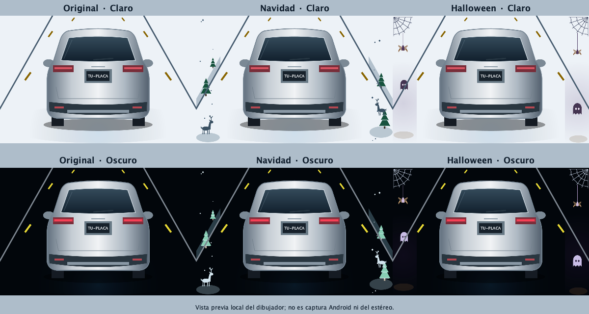

# FYT Smart Dashboard

Dashboard Android en Java basado en la implementación funcional **1.1.2 / versionCode 21**, para personalizar con Codex. Conserva la interfaz: velocímetro GPS animado, SUV trasero, carretera, reloj grande, clima, multimedia y dock de cinco aplicaciones.

**Preparación pública en revisión.** Apache-2.0 está aplicada al contenido propio con Copyright 2026 Luis Zapien. Aún no hay URL GitHub publicada ni garantía para todos los fabricantes. La distribución se prepara separada de los informes y datos privados del original.

## Entrega de código fuente para otras IA

Esta distribución se comparte como **fuentes y documentación**, sin APK, claves ni historial privado. Empieza por [Reproducir con otra IA](docs/reusable/AI_REPRODUCTION.md) y usa el [prompt inicial](prompts/00-replicate-source.md). El asistente debe leer AGENTS.md y auditar localmente antes de proponer cambios. No hace falta conectar un estéreo ni generar una APK para comenzar.

La firma Release y las pruebas físicas son pasos futuros si el receptor decide compilar o instalar. No bloquean la entrega de fuentes. El pendiente de atribución meteorológica se conserva documentado para que se resuelva antes de distribuir un binario con clima. No se ha publicado un repositorio remoto.

## Comenzar

1. Obtén la copia pública revisada, no la carpeta privada. Cuando exista una URL aprobada, podrás clonarla con Git o descargar su ZIP.
2. Sigue [Inicio rápido](docs/reusable/QUICKSTART.md): JDK 17, Android SDK Platform 35, Python 3 y Platform Tools.
3. Cuando autorices adaptar al hardware, conecta tu propio equipo si el firmware permite [ADB inalámbrico](docs/reusable/WIRELESS_ADB.md). No se presupone ADB habilitado ni puerto fijo.
4. Genera device-profile.json y device-report.md según [Diagnóstico y privacidad](docs/reusable/DEVICE_PROFILE.md).
5. Abre el proyecto con Codex y usa los [prompts por fases](prompts/README.md): primero inspección y plan aprobado; después cambios.
6. Si posteriormente quieres generar un binario, consulta [Compilación y firma](docs/reusable/BUILD_SIGNING.md). Compartir o analizar estas fuentes no ejecuta esa etapa. Instalar requiere autorización separada.

```sh
python3 tools/dashboard.py --help
python3 tools/dashboard.py doctor
# HOST, PORT y DEVICE son valores del equipo del usuario, no de un ejemplo histórico.
python3 tools/dashboard.py connect --host "$HOST" --port "$PORT"
python3 tools/dashboard.py profile --device "$DEVICE" --output profiles/private/mi-equipo
python3 tools/build.py debug --sdk "$ANDROID_HOME"
```

En Windows usa `py -3`. También hay lanzadores tools/dashboard.ps1 y tools/dashboard.sh. No cambies la política de ejecución de PowerShell: la invocación Python basta.

## Funciones existentes

- Velocidad y rumbo GPS válidos; sin señal se muestra --. No se inventan lecturas.
- SUV genérico sin marca, dibujado con Canvas; carretera animada, matrícula editable, Original/Navidad/Halloween y animaciones opcionales.
- Claro, Oscuro y Automático: claro de 07:00 a antes de 18:00 según hora local del Android; oscuro el resto.
- Clima Open-Meteo y botón circular de actualización. Requiere ubicación e Internet; no es temperatura exterior del vehículo.
- Widget Amazon Music/YouTube Music/NavRadio+, condicionado a permisos y MediaSession de cada aplicación.
- Cinco accesos: Radio/NavRadio+, Waze, Google Maps, Amazon Music y YouTube Music. Navegación como apps independientes.
- SOURCE abre App Drawer; mantener SOURCE abre ajustes.
- Arranque/reanudación y GPS continuo con servicio visible. No se fuerza abrir Maps o radio al iniciar.

## Referencia y límites

FYT UIS7862 / plataforma declarada 6315, Android 10/API 29, pantalla 1280×720. Otras unidades necesitan diagnóstico y pruebas. La app es candidata HOME; nunca selecciona HOME automáticamente ni sustituye OEM.

No hay integración activa de volante/Binder FYT, MCU/CANBUS o temperatura exterior. Luces del automóvil decorativas. Dock y MediaSources están vinculados al caso de referencia: editar el JSON SOURCE no reconfigura por sí solo todo el dock o el widget.

Java 17 · Wrapper 9.6.0 · AGP 8.7.3 · compileSdk 35 · minSdk 26 · targetSdk 28. Sin dependencias runtime externas declaradas. En la copia pública, ExpiredTargetSdkVersion permanece como advertencia explícita: Release y Lint completo pasan con 0 errores y 21 advertencias. Eso no moderniza el SDK ni satisface Google Play. Los binarios históricos no se incluyen en esta entrega. La firma y distribución de una APK requerirían un proceso posterior; no se generan aquí.

## Documentación

- [Base y auditoría](docs/reusable/BASELINE.md)
- [Arquitectura e interfaces propuestas](docs/reusable/ARCHITECTURE.md)
- [Compatibilidad y degradación](docs/reusable/COMPATIBILITY.md)
- [Personalización con Codex](docs/reusable/CUSTOMIZATION.md)
- [Ejemplo FYT sin identificadores](profiles/examples/fyt-uis7862.json)
- [Revisión pública](docs/reusable/PUBLIC_RELEASE.md)
- [Recursos y licencias](docs/reusable/ASSETS_AND_LICENSES.md)
- [Guion de video](docs/reusable/VIDEO_SCRIPT.md)
- [Cambios](CHANGELOG.md)

## Licencia y redistribución

**Copyright 2026 Luis Zapien.** Las aportaciones propias del código, herramientas, pruebas, documentación y recursos gráficos originales se distribuyen bajo [Apache License 2.0](LICENSE). Los componentes identificados en [avisos de terceros](THIRD_PARTY_NOTICES.md) conservan sus licencias, titulares y condiciones; no se relicencian SDK, servicios, datos meteorológicos, contenido multimedia ni aplicaciones externas.

Puedes usar, modificar y redistribuir las aportaciones cubiertas, incluso comercialmente, cumpliendo LICENSE. Al distribuir fuentes o binarios derivados, incluye la licencia, conserva los avisos aplicables de copyright/atribución y NOTICE, e identifica los archivos que hayas modificado. Conserva también los avisos de terceros que correspondan. No se conceden derechos generales sobre marcas ni respaldo de fabricantes. Estos recordatorios no sustituyen el texto completo de la licencia.

[NOTICE](NOTICE) identifica el copyright del proyecto. La APK incluye copias de LICENSE, NOTICE y los avisos en assets/legal; las fuentes incluyen además la licencia original del Wrapper Gradle. La selección y aplicación se documentan en [licencia pública](docs/reusable/PUBLIC_LICENSE.md). La API meteorológica tiene términos separados y su atribución visible continúa pendiente antes de distribuir binarios con clima.

El vehículo público y los vectores heredados se sustituyeron por geometrías genéricas propias; no se distribuyen las imágenes anteriores del vehículo de referencia. La licencia no garantiza compatibilidad con todos los estéreos Android. Consulta [recursos y pendientes](docs/reusable/ASSETS_AND_LICENSES.md) y [vehículo genérico](docs/reusable/GENERIC_VEHICLE.md) antes de redistribuir fuentes o APK.



[Resultados y pendientes de validación](docs/reusable/VALIDATION.md).

- [Auditoría final y requisitos de publicación](docs/reusable/FINAL_PUBLICATION_AUDIT.md)
- [Firma pública con credenciales externas: propuesta sin activar](docs/reusable/PUBLIC_SIGNING_PLAN.md)
