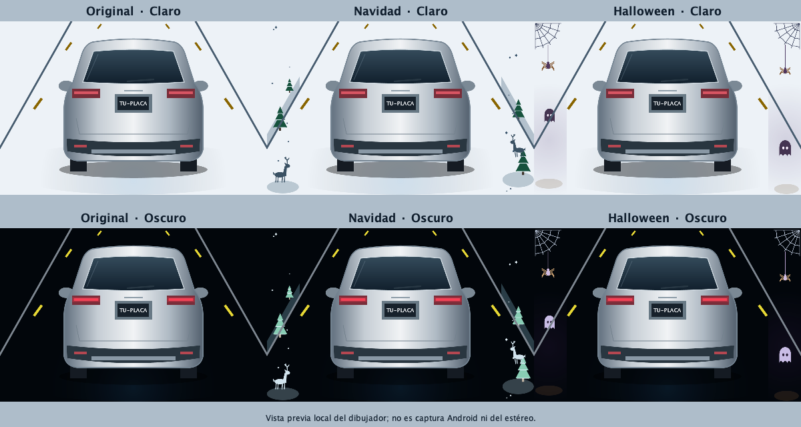

# Vehículo genérico de la distribución pública

Actualización autorizada: 6 de noviembre de 2026. Solo afecta a esta copia pública; la personalización del proyecto privado y del estéreo no se modifica.

## Implementación

- GenericVehicleArtwork.java dibuja con Canvas una vista trasera de SUV plata sin logotipos, texto de fabricante ni geometrías copiadas de un modelo concreto. Paths y gradientes se construyen una vez, no se descargan imágenes ni se decodifican bitmaps.
- SuvRearView conserva carretera, movimiento ligado al GPS, matrícula editable, temas, ciclos de vida y luces decorativas por horario. Solo cambia la geometría de las lámparas para alinearla con el vehículo genérico. No hay datos CANBUS nuevos.
- Se retiran de esta copia los dos WebP del vehículo de referencia y su PNG maestro; el preview público se regenera desde el código nuevo. No queda una dependencia de esos archivos en las pruebas o el exportador público.
- car.xml, car_front.xml, plane_takeoff.xml, circle_letter_p.xml y sus cuatro backups se sustituyen por trazos nuevos; no se les asigna un autor externo por semejanza ni se usa contenido descargado.
- No cambian GPS, velocímetro, brújula, reloj, clima, multimedia, dock, App Drawer, permisos, SDK, paquete, versión o configuración de firma.

## Verificación local

| Comprobación | Resultado |
|---|---|
| assembleDebug / assembleRelease | BUILD SUCCESSFUL |
| assembleDebugAndroidTest | BUILD SUCCESSFUL; no instalada ni ejecutada |
| Lint Debug y Release | 0 errores; 21 advertencias anteriores; ninguna nueva |
| ExpiredTargetSdkVersion | Sigue visible como Warning, sin cambiar targetSdk 28 |
| Pruebas Java | 14 suites PASS |
| Herramientas/privacidad | 17 tests PASS, ADB simulado |
| Canvas local | 265 comprobaciones: 256 de decoraciones y 9 de visibilidad/límites/matrícula del nuevo vehículo en tres escalas |
| Velocímetro Canvas local | Render de estados de prueba en claro/oscuro correcto; no datos GPS de producción |
| APK Debug | Firma de desarrollo verificada; no usar como firma pública definitiva |
| APK Release | Sin firma pública; no está lista para distribución binaria |
| Recursos APK | CRC correcto; sin imágenes anteriores ni referencias a su fabricante/modelo en nombres o contenido UTF-8/UTF-16 |
| Proyecto original | Código/recursos y configuración preservados por comparación SHA-256 con referencia previa |

Las vistas previas usan un puente Java2D sobre el código Canvas de producción: no son capturas Android, no prueban renderizado exacto en el estéreo ni rendimiento real. Se revisaron las seis combinaciones Original/Navidad/Halloween y Claro/Oscuro. No se usó ADB, instaló APK o alteró HOME.

## Licencia y publicación

Apache-2.0 ya está aplicada a las aportaciones propias con Copyright 2026 Luis Zapien, tras la selección y los datos proporcionados por el usuario. LICENSE contiene el texto oficial completo; NOTICE y THIRD_PARTY_NOTICES.md separan los avisos del proyecto y los componentes ajenos. El vehículo genérico y su preview forman parte del alcance propio; no se incluyen los recursos anteriores del fabricante.

Conservar avisos originales de Gradle. Siguen pendientes la atribución visible de Open-Meteo junto al clima, la firma pública y las pruebas autorizadas en equipos de destino antes de distribuir APK. Una licencia no garantiza compatibilidad con todos los estéreos o Android.

